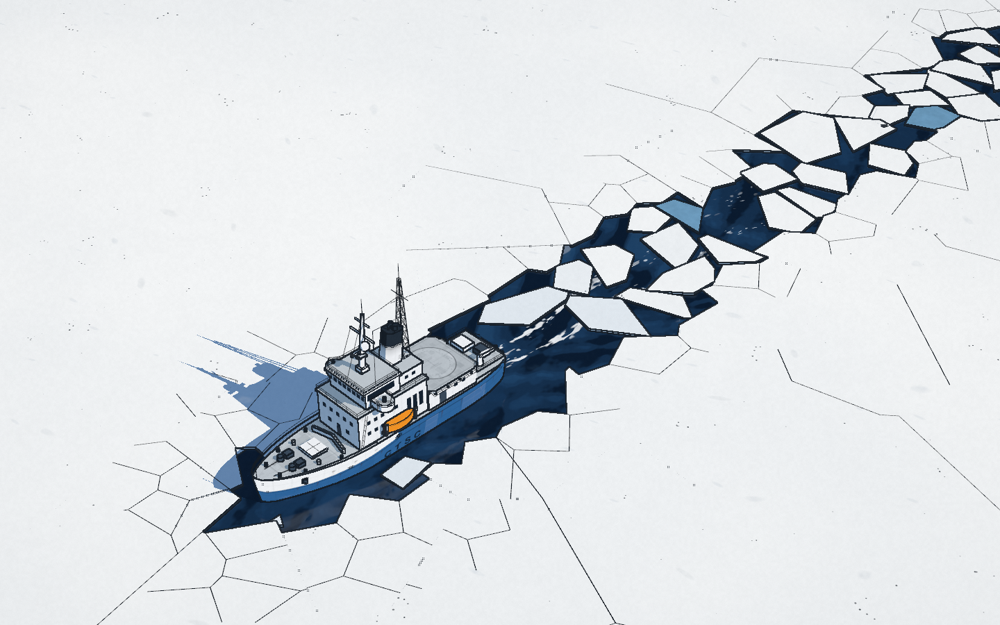
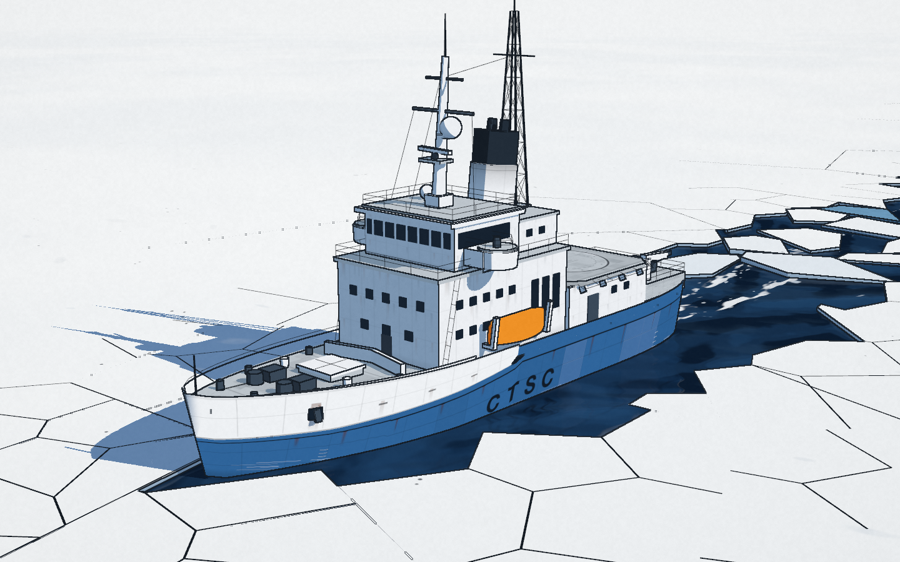

# CTSC Polar Icebreaker 3D

**English** · [中文](README.zh-CN.md) · [Português](README.pt.md)

An interactive 3D **Ligne Claire / Japanese editorial architectural illustration** polar icebreaker voyage built with **Three.js** and a custom multi-pass GLSL rendering pipeline — zero external 3D models or image textures, 100% procedural geometry, weathering, rigid-body ice physics, and shaders.



## Highlights

- **Multi-Pass Ligne Claire Pipeline**: Real-time planar water reflection pass + MSAA cel-shaded beauty buffer + Octahedral Normal / Linear Depth / Part-ID G-Buffer + Roberts-Cross screen-space India-ink contours + cold-press paper grain.
- **Restrained Polar Water & 3D Kelvin Wake**: Deep Prussian-indigo trochoidal swells, sculptural 3D undulating Kelvin V-waves & stern rollers, deeply absorbed subtle planar reflections, crisp twin-propeller wake foam, and sparse silver-blue crest glints.
- **Real-Time Voronoi Ice Fracture & 6-DOF Slab Physics**: Streaming macro-Voronoi ice sheet seamlessly fused with the infinite snowfield (zero seams on unbroken ice), bow-centered Westergaard radial + circumferential convex-polygon splitting with Lloyd relaxation, ahead-of-bow stress-crack propagation & flexural lip bending, 100% area-conserving jigsaw-complement detachment (with world-locked snow stipple texture), secondary slab crushing, and bistable 6-DOF quaternion buoyancy with spoon-bow 180° overturning (revealing wet glacial-blue undersides), under-hull transit, under-ice shelf rafting, and omni-directional channel breaking.
- **Heavy 15,000-Ton Vessel Handling**: Deliberate bridge telegraph vs. spooling propulsion shaft inertia, weighted hydraulic rudder & turning leeway, slow ~3s metacentric roll/pitch/heave periods, and tactile low-speed ice collision (bow ride-up onto unbroken ice lip, structural hull shudder, momentary arrest, and sluggish slide-back rebound).
- **Architectural Polar Icebreaker (`CTSC`)**: Procedural lofted spoon-bow hull, compact two-tier superstructure with cantilevered bridge wings, chamfered soot-weathered funnel, forward radar & aft lattice masts, chamfered helideck with anchored safety netting & hangar shutter door, safety-amber lifeboats, and graphic maritime weathering.
- **Trilingual UI (`中文 / EN / PT`) & 5 Fixed Camera Lenses**: Instant language switching via top-right toggle, `L` key, browser locale, or `?lang=zh|en|pt`; 5 curated editorial lenses (`Illustration`, `Bow Breaker`, `Aerial Wake`, `Bridge Wing`, `Stern Chase`).



## Controls

| Input | Action |
| --- | --- |
| **W / S** or **↑ / ↓** | Engine telegraph (Ahead / Astern) — low throttle (`~15–25%`) bumps & rebounds off solid ice; `≥34%` breaks through |
| **A / D** or **← / →** | Port / Starboard hydraulic rudder — heavy yaw momentum, curved channel carving & glancing ice-bank bumps |
| **Space** | All stop / heavy coasting deceleration |
| **1 – 5** or **C** | Switch / cycle the 5 fixed camera lenses |
| **L** | Cycle language (`中文` → `EN` → `PT`) |
| **R** | Reset voyage and ice sheet |
| **H** | Toggle Clean Illustration View (hide/show HUD) |

## Quick Start

```bash
npm install
npm run dev
```

Build and preview the production bundle:

```bash
npm run build
npm run preview
```

## Deploy to GitHub Pages

A ready-to-use GitHub Actions workflow is included at `.github/workflows/deploy.yml`:

1. Push this repository to GitHub on the `main` branch.
2. Open **Settings → Pages** and set **Source** to **GitHub Actions**.
3. The workflow automatically builds `dist/` (with relative `base: './'`) and publishes your live interactive demo.

## License

[MIT](LICENSE)
