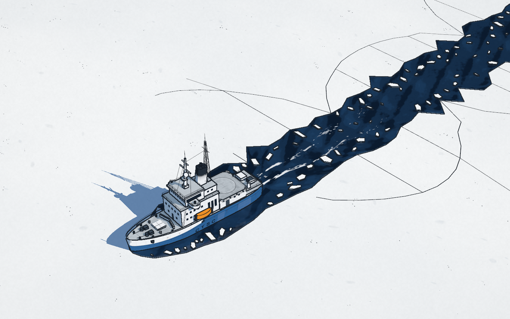
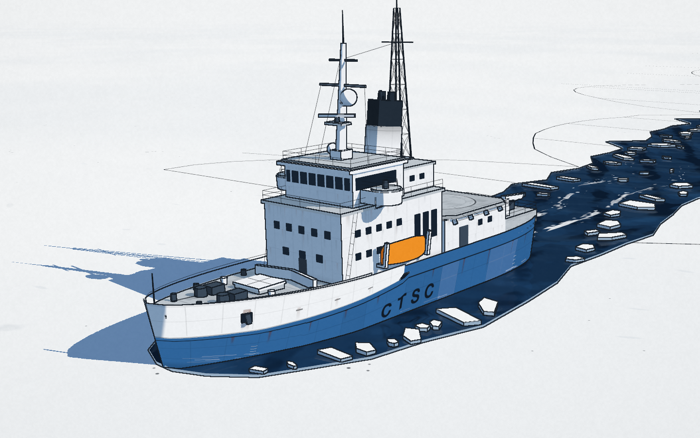

# CTSC Quebra-Gelo Polar 3D

[English](README.md) · [中文](README.zh-CN.md) · **Português**

Uma cena interativa 3D de navegação polar no estilo **Ligne Claire / ilustração arquitetônica editorial japonesa**, desenvolvida com **Three.js** e um pipeline GLSL multipasse personalizado — 100% procedural, sem modelos 3D ou texturas externas.



## Destaques

- **Pipeline Ligne Claire Multipasse**: Reflexo planar em tempo real na água + passo cel-shaded com MSAA + G-Buffer de normal octaédrica, profundidade linear e ID de peça + contornos nítidos em nanquim (Roberts Cross) + textura sutil de papel prensado a frio.
- **Mar Polar Contido e Esteira de Kelvin 3D**: Ondulação trocoidal em azul-da-prússia profundo, ondas de Kelvin 3D em V e rolos de popa, reflexos planares suavemente absorvidos, espuma de hélices duplas e brilhos solares discretos.
- **Gelo Quebrado Rígido Sem Sobreposição**: Canal aberto recortado por stencil com bolso de proa persistente (não recongela ao dar ré), rede radial e curva de fraturas e blocos/lascas angulares desprendidos continuamente pela proa, resolvidos por colisão exata 2D SAT de polígonos convexos com torque de casco.
- **Condução Pesada de 15.000 Toneladas e Impacto em Baixa Velocidade**: Telégrafo do passadiço separado da inércia lenta do eixo propulsor, leme hidráulico pesado com deriva lateral, períodos lentos de balanço (~3s) e contato tátil em baixa velocidade (proa sobe sobre a borda do gelo, vibra, detém-se e recua suavemente).
- **Arquitetura Detalhada do Quebra-Gelo (`CTSC`)**: Casco polar com proa tipo colher, superestrutura compacta com asas de passadiço esguias, chaminé chanfrada com fuligem, mastro de radar e torre treliçada à ré, helideque chanfrado com rede de segurança e porta do hangar, baleeiras laranja e desgaste marítimo gráfico.
- **Interface Trilíngue (`中文 / EN / PT`) e 5 Câmeras Fixas**: Troca rápida no canto superior direito, tecla `L`, detecção do idioma do navegador ou `?lang=zh|en|pt`; 5 enquadramentos editoriais curados.



## Controles

| Comando | Ação |
| --- | --- |
| **W / S** ou **↑ / ↓** | Telégrafo do motor (Avante / Ré) — baixa potência (~15–25%) encosta e recua no gelo; ≥34% rompe a banquisa |
| **A / D** ou **← / →** | Leme hidráulico Bombordo / Boreste — inércia de guinada pesada e toques laterais na borda do gelo |
| **Espaço** | Parar máquinas / desaceleração por inércia |
| **1 – 5** ou **C** | Alternar entre as 5 câmeras fixas |
| **L** | Alternar idioma (`中` → `EN` → `PT`) |
| **R** | Reiniciar rota e banquisa |
| **H** | Ocultar / mostrar interface (Modo Ilustração Limpa) |

## Executar Localmente

```bash
npm install
npm run dev
```

Compilar e pré-visualizar a versão de produção:

```bash
npm run build
npm run preview
```

## Publicar no GitHub Pages

O repositório já inclui o workflow `.github/workflows/deploy.yml`:

1. Envie o repositório para o GitHub na branch `main`.
2. Em **Settings → Pages**, selecione **GitHub Actions** em **Source**.
3. O site interativo será compilado e publicado automaticamente a cada push.

## Licença

[MIT](LICENSE)
