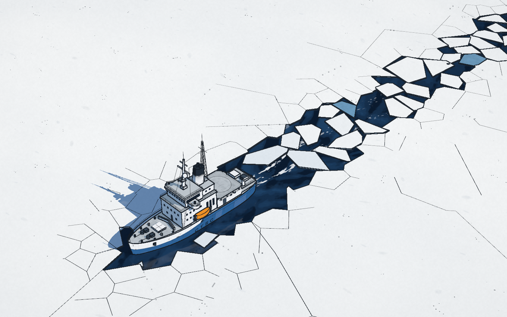
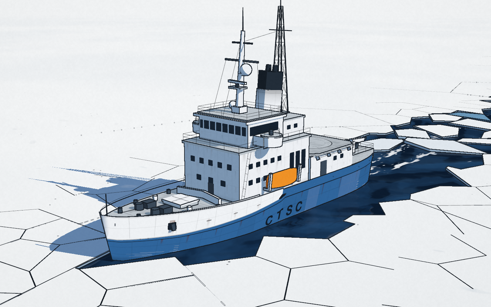

# CTSC 极地破冰船 3D（Polar Icebreaker 3D）

[English](README.md) · **中文** · [Português](README.pt.md)

基于 **Three.js** 与自定义多通道 GLSL 渲染管线构建的 **Ligne Claire（清线法漫）/ 日系建筑插画风格** 3D 极地破冰船交互场景。全场景 100% 程序化建模、刚体碎冰物理与着色，无需任何外部 3D 模型或位图素材。



## 特色亮点

- **多通道清线插画管线**：实时水面平面反射通道 + MSAA 赛璐璐色彩通道 + 八面体法线 / 线性深度 / 部件 ID G-Buffer + 屏幕空间匀线墨水描边 + 冷压水彩纸纹理复合。
- **克制深邃的极地海面与 3D 开尔文尾浪**：深普鲁士蓝摆线海涌、3D 起伏开尔文 V 形波与船尾横滚波、低饱和深海吸收式倒影、羽状双桨白沫与克制的浪峰细微高光。
- **真实流式 Voronoi 碎裂与 6-DOF 破冰物理**：活跃区由无缝拼接的宏观 Voronoi 凸多边形冰原构成（未碎区域零接缝），船艏触冰时围绕接触点实时生成 Westergaard 放射状 + 环向凸多边形劈裂（含 Lloyd 质心松弛杜绝狭长碎条）；支持船艏前方应力裂纹先行蔓延、冰缘受压下弯、100% 面积守恒的拼图互补整块脱离（雪面墨点随冰块锁定移动）、大块浮冰二次碾碎，以及四元数双稳态 6-DOF 浮力——再现勺形船艏下压撬翻 180° 露出湿润蓝绿冰底、船底滑行、冰盖下方叠覆（Rafting）与任意航向自由破壁。
- **万吨重船操作手感与低速触冰碰撞**：舰桥车钟与推进轴大惯性滞后、重型液压舵与转向余摆/横漂、约 3 秒大周期稳心摇摆；低速（约 15%–25% 进车或滑行）触碰冰缘时呈现真实的船首受阻翘起、钢壳低频震颤、短暂停滞与缓慢滑落回弹，加车后进入「爬冰—受阻—断裂—船首沉落」的重型破冰节奏。
- **精细极地破冰船建筑建模（CTSC）**：程序化勺形破冰船首、紧凑双层上层建筑与流线舰桥翼台、倒角烟囱与烟熏做旧、前雷达桅杆与后桁架桅杆、倒角停机坪（含外挑安全网、机库卷帘门与着陆圆环）、安全橙救生艇与水线冰擦痕/锈迹。
- **中 / 英 / 葡三语界面与 5 个精选固定机位**：支持右上角切换、`L` 快捷键、浏览器语言识别及 `?lang=zh|en|pt` 参数；内置插画俯视、船首破冰、航迹俯瞰、舰桥侧翼、尾迹低角 5 个机位。



## 操作说明

| 按键 | 功能 |
| --- | --- |
| **W / S** 或 **↑ / ↓** | 主机车钟进车 / 倒车（低推力约 15%–25% 触冰受阻回弹，≥34% 持续破冰前进） |
| **A / D** 或 **← / →** | 左右液压操舵转向，具备重船惯性余摆与冰壁肩部擦撞反馈 |
| **Space** | 停机减速（开阔水面长距离惯性滑行，冰层内高阻制动） |
| **1 – 5** 或 **C** | 切换 / 循环 5 个固定机位镜头 |
| **L** | 循环切换界面语言（`中` → `EN` → `PT`） |
| **R** | 重置航线与冰原 |
| **H** | 隐藏 / 显示界面（纯净插画赏析模式） |

## 本地运行

```bash
npm install
npm run dev
```

构建生产包与本地预览：

```bash
npm run build
npm run preview
```

## 一键部署到 GitHub Pages

仓库已内置 `.github/workflows/deploy.yml`：

1. 将本项目推送到 GitHub 的 `main` 分支。
2. 在仓库 **Settings → Pages** 中将 **Source** 选择为 **GitHub Actions**。
3. 推送后将自动构建并发布在线可交互演示页。

## 开源协议

[MIT](LICENSE)
